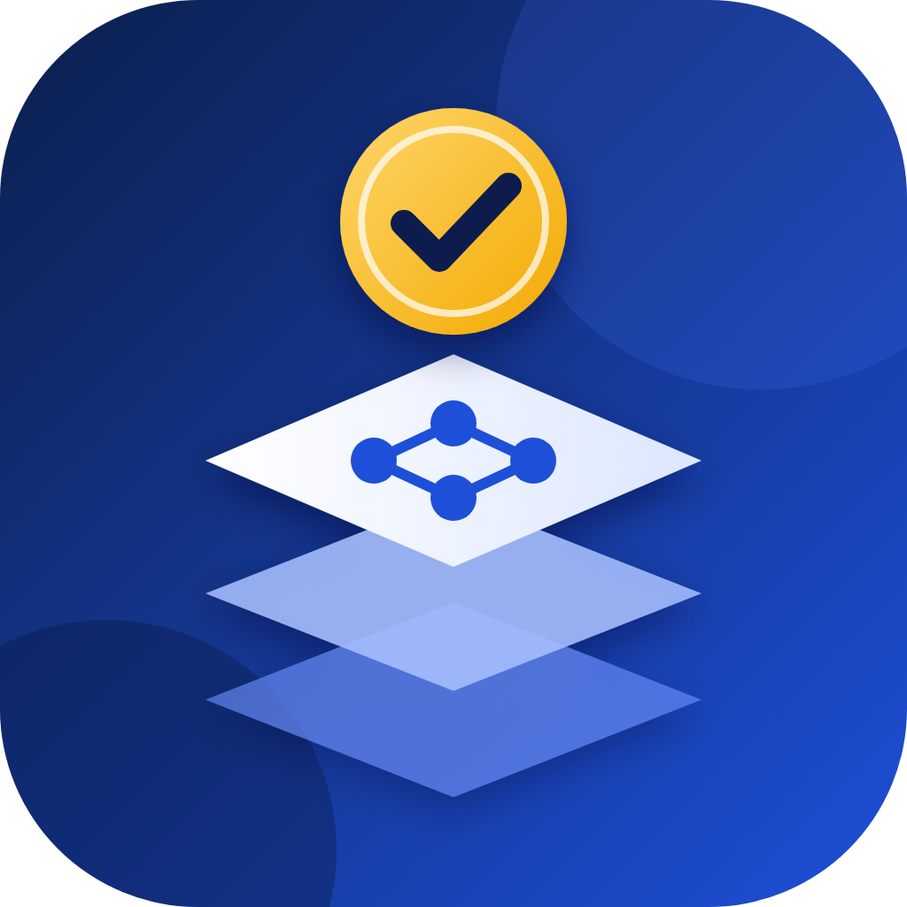
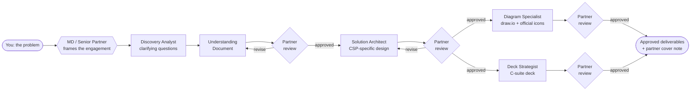

<p align="center">
  
</p>

<h1 align="center">AI Solutions Consultant</h1>

<p align="center">
  <b>A consulting team inside Claude: discovery, architecture, draw.io diagrams and C-suite decks.</b><br/>
  Every deliverable is reviewed and signed off by an MD / Senior Partner agent before you see it.
</p>

<p align="center">
  
  
  
  
</p>

---

## Why this exists

Architecture work for a client usually means four people and two weeks: someone runs discovery, an architect designs, someone else draws it in Visio or draw.io, and an engagement manager turns it into a deck the CIO will read. Then a partner tears it apart and it all goes round again.

This plugin puts that whole team into Claude, with the partner's quality gate built in. You describe the problem; it asks the questions a good consultant would ask, then produces the documents, the cloud diagrams and the deck. Each one passes a partner review before it reaches you.

## What you get

| Deliverable | What it contains | Format |
|---|---|---|
| **Clarifying questions** | The 4–8 questions whose answers change the design, asked as quick multiple-choice rounds | In chat |
| **Understanding Document** | Executive summary, scope in/out, as-is and to-be process, numbered FR/NFR, integration inventory, assumptions, risks, open questions | Living doc, Markdown or Word |
| **Target architecture** | Principles, logical layers, key flows, CSP-specific deployment view, integration view, security controls, AI governance, ADRs, roadmap | Living doc, Markdown or Word |
| **Architecture diagrams** | Context, logical, deployment, network or current-vs-proposed views using the **official Azure, AWS or GCP icon sets** | draw.io, plus a one-click **Open in draw.io** link and a `.drawio` file |
| **Executive deck** | Answer-first storyline, action titles, exhibits instead of bullets, sources on every slide, decisions requested | Claude Slides or PowerPoint |
| **Partner review note** | Scores, what changed in revision, residual risks, the one-sentence takeaway | Attached to every deliverable |

## How it works



Only the stages you ask for run. Ask for a diagram and you get a diagram, not an unrequested deck.

## The team

| Agent | Plays the role of | Owns |
|---|---|---|
| 🎩 **md-senior-partner** | MD / Senior Partner at a top-tier strategy and technology firm | Framing, dispatching the team, reviewing and approving every artifact, consistency across deliverables, the closing cover note |
| 🔎 **discovery-analyst** | Senior consultant | Clarifying questions and the Understanding Document |
| 🏗️ **solution-architect** | Principal enterprise and cloud architect | Logical and CSP-specific architecture, AI-integration patterns, NFRs, security, ADRs |
| 🗺️ **diagram-specialist** | Architecture visualization lead | draw.io diagrams with official provider icons, Open in draw.io link |
| 📊 **deck-strategist** | Engagement manager | Storyline, ghost deck, executive slides, speaker notes |

## The partner review gate

Every artifact is scored 1–5 against a scorecard for its type. It ships only when **every dimension scores 4 or more and no must-fix item remains**. Otherwise it goes back to its author with numbered, exact fixes, for up to two revision rounds.

| Artifact | Scored on |
|---|---|
| Understanding Document | Completeness · accuracy and sourcing · requirement quality · current vs target clarity · risk coverage · executive readability |
| Architecture | Traceability to requirements · soundness · trade-offs · security and compliance · resilience · CSP fidelity · AI governance |
| Diagram | Official icon fidelity · correctness · structure and nesting · flow clarity · readability · new vs existing · draw.io link delivered |
| Deck | Storyline · action titles · evidence · audience fit · visual quality · the ask · consistency |

Example of what comes back with an approved deck:

```
Partner review: Executive deck: APPROVED (round 2)
Scores: Storyline 5 · Action titles 5 · Evidence 4 · Audience fit 5 · Visual 4 · The ask 5 · Consistency 5
Changed in revision: slide 4 title rewritten as a takeaway; physical diagram moved to appendix;
                     decisions slide now names owners and dates
Residual: go-live date and SMS gateway API route still [TBC]
Takeaway: one new AI layer, no rip-and-replace, three decisions needed today
```

## Cloud coverage

| Provider | Icon library used in draw.io | Service mapping |
|---|---|---|
| **Microsoft Azure** | Official Azure architecture icons (`azure2`) | Landing zones, hub-spoke, Private Endpoints, Azure OpenAI / AI Foundry, AI Search, API Management AI gateway, and more |
| **AWS** | Current AWS Architecture Icons (`aws4`) | Organizations, VPC, PrivateLink, Bedrock, Connect, Transcribe, API Gateway, and more |
| **Google Cloud** | Google Cloud product icons (`gcp2` / current set) | VPC, Private Service Connect, Vertex AI, CCAI, Apigee, and more |
| **On-prem and hybrid** | Network, data-center and telephony shapes | SBCs, PBX / contact center, DMZ, ExpressRoute / Direct Connect / Interconnect, trust boundaries |

The plugin never draws a cloud service as a plain box when an official icon exists, and every diagram comes with a clickable link that opens it in draw.io.

## Quick start

1. **Install the plugin**
   - **Claude Cowork:** add `bedirachit/ai-solutions-consultant` as a plugin marketplace, then install **ai-solutions-consultant**. Or open the `.plugin` file in the Claude desktop app and accept it.
   - **Claude Code:**
     ```
     /plugin install ai-solutions-consultant --marketplace bedirachit/ai-solutions-consultant
     ```
2. **Connect draw.io** in Settings → Connectors. This is recommended for inline previews and icon search. Without it the plugin still produces the `.drawio` file and the open link.
3. **Start a task** and describe the problem.

## Try saying

> *Act as my AI solutions consultant. A retail bank wants a voice bot for credit card service calls on Azure, integrated with its on-prem contact center. I need an understanding document, the target architecture with an Azure diagram, and a deck for the CIO.*

> *Ask me what you need to know, then design an AWS architecture for a RAG assistant over our policy documents.*

> *Draw the current vs proposed inbound call flow in draw.io.*

> *Review this deck like a senior partner before it goes to the COO.*

> *Compare running the vendor as SaaS versus inside our GCP project, and write the ADR.*

## Skills inside

| Skill | Triggers on |
|---|---|
| `solution-engagement` | "Act as my solutions consultant", "run the full engagement" |
| `discovery-questions` | "What do you need to know", "scope this", "clarify requirements" |
| `understanding-document` | "Understanding document", "requirements understanding", "as-is / to-be" |
| `solution-architecture` | "Target architecture", "Azure / AWS / GCP architecture", "trade-offs", "NFRs" |
| `csp-architecture-diagram` | "Draw the architecture", "draw.io", "official cloud icons", "deployment diagram" |
| `executive-deck` | "Deck", "slides", "PPT", "C-suite / board presentation" |
| `partner-review` | "Review like a partner", "is this C-suite ready" |

## Principles the team works by

- **Clarify before designing, quantify before choosing.** "High volume" becomes a number before it shapes a design.
- **Justify every component** by what it solves, what it worsens and when you'd change it.
- **Never invent facts.** Unknown figures become `[TBC]` placeholders and open questions, never guesses.
- **Secure by default.** Least privilege, private connectivity, AI accessed through a governed gateway, and a human or legacy fallback on every automated path.
- **Write for the reader.** Executives get outcomes, risk and decisions; architects get components, interfaces and trade-offs.

## Repository layout

```
.claude-plugin/marketplace.json        marketplace manifest
plugins/ai-solutions-consultant/
├── .claude-plugin/plugin.json         plugin manifest + icon
├── .mcp.json                          draw.io connector
├── agents/                            md-senior-partner + 4 specialists
└── skills/
    ├── solution-engagement/           end-to-end workflow and review gates
    ├── discovery-questions/           question bank by dimension
    ├── understanding-document/        document template
    ├── solution-architecture/         building blocks, AI patterns, CSP service map, trade-offs, security
    ├── csp-architecture-diagram/      Azure / AWS / GCP / hybrid icon guides, layout rules, draw.io link script
    ├── executive-deck/                slide patterns and storyline rules
    └── partner-review/                scorecards
```

## FAQ

**Does it work without the draw.io connector?**
Yes. It writes the draw.io XML, saves a `.drawio` file and generates the Open in draw.io link. The connector adds inline previews and searching the official icon libraries.

**Can it use my company's slide template or design system?**
Yes. Name the template or design system and the deck strategist builds with it.

**Is my data sent anywhere?**
The plugin itself collects nothing. Content goes only to Claude and to the connectors you choose. See [PRIVACY.md](PRIVACY.md). Open in draw.io links carry the diagram inside the URL, so don't share links to confidential diagrams.

**Can I change the partner's bar?**
Yes. Edit `skills/partner-review/references/scorecards.md` to change the dimensions, the approval threshold or the must-fix list.

## Roadmap

- Industry packs: banking, insurance, telecom, public sector
- Cost estimation with provider pricing calculators
- Diagram-to-image export embedded straight into decks
- Confluence and SharePoint publishing of approved artifacts

## Contributing

Issues and pull requests are welcome. Please keep client-specific details out of examples.

## Credits

The system-design and AI-integration guidance is condensed and rewritten from ideas in the MIT-licensed [system-design-skills](https://github.com/proyecto26/system-design-skills) and [ai-integration-architect](https://github.com/pfbarros2/ai-integration-architect) plugins.

## License

[MIT](LICENSE) © 2026 Yash Verma
