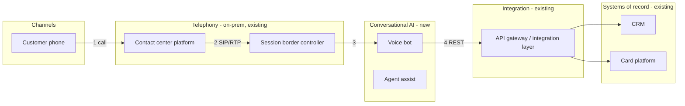
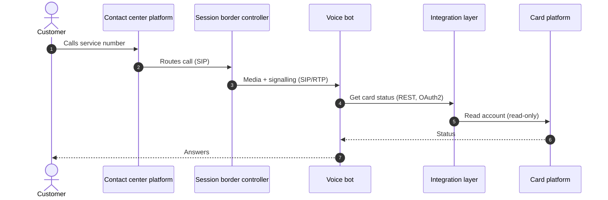

# [Client] — [Solution]: Solution Architecture Document

| Version | Date | Authors | Reviewed by | Status | Audience |
|---|---|---|---|---|---|
| 0.1 | [date] | [names] | [partner] | Draft for client architecture review | [Client] enterprise architecture, platform, security, application and delivery teams |

> **How to read this document.** Section 3 shows the whole solution on one page. Section 4 explains every component. Section 5 walks through each journey step by step. Sections 6–10 cover deployment, integration, security, operations and AI controls. Decisions and their reasons are in Section 11.

## 1. Summary (half a page)
- What we are building and for whom, in three sentences.
- What is new and what stays as it is.
- The three design choices that matter most, each in one line with its reason.

## 2. Scope, requirements and principles
- In scope / out of scope for this release (link to the Understanding Document).
- Requirements this architecture satisfies: table of FR/NFR ids → section where each is addressed.
- Architecture principles (5–7), each with what it means in practice here.

## 3. Architecture overview

*Figure 1 — Architecture overview. Numbers match Section 5.* [Replace with the solution's components; insert the draw.io export here when available, with its Open in draw.io link.]

One paragraph per layer: what the layer is for and which components sit in it.

## 4. Component catalogue
Repeat for each component (new and existing ones the solution depends on).

### 4.n [Component name] — [new | existing | changed]
| | |
|---|---|
| **Role** | What it is in this solution, in one sentence |
| **Purpose** | The business or technical need it serves (FR/NFR ids) |
| **Responsibilities** | 3–6 bullets: what it does and, importantly, what it does not do |
| **Inputs / outputs** | Data it receives and produces |
| **Interfaces** | Systems it talks to, protocol, direction, authentication |
| **Technology / service** | Product or cloud service, SKU/tier if decided, region |
| **Owned and operated by** | Team at [Client] or vendor |
| **Scaling and resilience** | How it scales, what happens when it fails, fallback |
| **Security** | Identity, network placement, data it holds, encryption |
| **Why this choice** | Reason, and the alternative(s) considered (see ADR-n) |

## 5. Key journeys and flows
Repeat for each key journey (2–4).

### 5.n [Journey name, e.g. "Inbound card-servicing call"]

*Figure 5.n — [Journey] flow.* [Replace with the real journey.]

| Step | Component | What happens | Data | Protocol / auth |
|---|---|---|---|---|
| 1 | | | | |

**Alternate and failure paths:** what happens when the bot cannot resolve the request, a system is down, the customer asks for an agent.

## 6. Deployment view
Environments (dev / test / prod), regions, networks and subnets, private connectivity, what runs on-prem vs cloud vs vendor SaaS. Include the CSP deployment diagram (official icons) when produced.

## 7. Integration view
| # | From → To | Purpose | Pattern | Protocol | Auth | Data | Volume / latency | Owner |
|---|---|---|---|---|---|---|---|---|

## 8. Security and compliance
Identity and access, network security, data protection, secrets, logging and audit, compliance mapping (regulation → control → where implemented).

## 9. Non-functional design and operations
Capacity estimate (with the arithmetic), scalability, availability and DR (RTO/RPO), performance budget per journey, observability (metrics, logs, traces, SLOs, alerts), support model and runbooks.

## 10. AI design and governance (if applicable)
Models and access path (AI gateway), grounding and knowledge sources, guardrails, evaluation approach and metrics, human-in-the-loop, model risk management.

## 11. Architecture decisions
ADR table: decision, options considered, choice, reason, consequences. Note where the design follows or departs from the reference architectures in the Research Brief.

## 12. Risks, assumptions and open questions
Tables with ids, owners and dates.

## 13. Implementation roadmap
Phases with scope, dependencies and exit criteria.

## Appendix
Glossary, references (Research Brief sources), detailed diagrams.
